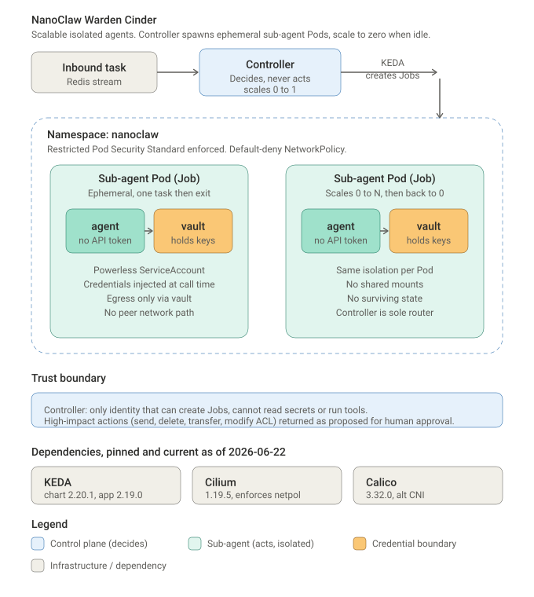

# NanoClaw Warden Cinder

Ephemeral, isolated AI agents on Kubernetes. They spark when there's work and burn out clean when there isn't.


Versions pinned and verified against upstream releases on 2026-11-22. The full list lives in [`versions.env`](versions.env).

## What it does

You put a task on a queue. A controller splits it into subtasks. KEDA starts one Kubernetes Job per subtask, each running a single agent in its own locked down pod. Agents call the model through a vault gateway that holds the only API key and is the only thing allowed out of the cluster. Results come back, proposed actions wait for a human, and then everything scales back to zero. Redis is the only pod that stays up.



| | Idle | Busy |
|---|---|---|
| Redis | 1 pod | 1 pod |
| Controller | 0 | 1 |
| Agents | 0 | 1 per waiting subtask, up to 20 |
| Vault | 0 | 1 per 8 agents, up to 3 |

## Why it's built this way

Prompt injection is the top risk on the OWASP list for LLM apps, and nobody has a reliable fix. So this design doesn't depend on the model behaving. If an agent is fully hijacked:

- it has no Kubernetes API token and no role, so it can't touch the cluster
- it has no API key, only a token good for one subtask and 20 calls
- it can reach Redis and the vault, nothing else. Not the internet, not its peers
- it can't run anything. Tool use turns into a proposal that a person approves
- its pod is gone when the subtask ends, so nothing poisoned carries over

Admission policies inside the API server back all of that up. Only KEDA can create Jobs in the namespace, only approved images run, and no pod gets a service account token or a debug container.

## Quick start

```bash
./scripts/preflight.sh                                   # read only check
./scripts/install.sh                                     # KEDA if missing (asks first)
kubectl apply -f deploy/base/namespace.yaml
./scripts/gen-secrets.sh --api-key-file ~/.secrets/anthropic.key
kubectl apply -k deploy/overlays/cilium                  # or deploy/overlays/calico
```

Then send it work:

```bash
kubectl -n nanoclaw port-forward svc/redis 6379:6379 &
export PYTHONPATH=src REDIS_HOST=127.0.0.1 REDIS_USERNAME=client REDIS_PASSWORD_FILE=./nanoclaw-client.pass
python3 -m nanoclaw cli submit --goal "Review the incident" --subtask "Timeline" --subtask "Root causes" --wait 600
```

The full walk through, including a laptop option on kind, is in [docs/QUICKSTART.md](docs/QUICKSTART.md).

## Requirements

| Component | Version | Why |
|---|---|---|
| Kubernetes | 1.32 or newer | ValidatingAdmissionPolicy v1 and native sidecars |
| KEDA | 2.21.1 (2.21.0 minimum) | Redis Streams `lagCount` scaling to zero. 2.21.0 fixes CVE-2026-77524 |
| Cilium | 1.20.5 | recommended. Hostname based egress for the vault |
| Calico | 3.33.1 | alternative. Address range egress for the vault |
| Redis | 8.12.0 | ships in the manifests. Lag needs 7.0 or newer, the ACLs need 7.2 or newer |

The CNI has to enforce NetworkPolicy. Flannel on its own doesn't, and `preflight.sh` will tell you.

## Docs

| Doc | Read it for |
|---|---|
| [QUICKSTART](docs/QUICKSTART.md) | getting it running |
| [HOW_IT_WORKS](docs/HOW_IT_WORKS.md) | the full design: data flow, scaling, every security layer, failure handling |
| [CONFIGURATION](docs/CONFIGURATION.md) | every setting, secrets, gVisor, digest pinning, durable Redis |
| [THREAT_MODEL](docs/THREAT_MODEL.md) | what it defends against and what it doesn't |
| [REDTEAM_MATRIX](docs/REDTEAM_MATRIX.md) | technique by technique self assessment, with the test that covers each row |
| [CONTROLS](docs/CONTROLS.md) | NIST SP 800-53 Rev 5 mapping |
| [TESTING](docs/TESTING.md) | the regression suite and the latest results |
| [CHANGELOG](CHANGELOG.md) | what changed in 0.2.0 |

## Testing

```bash
./scripts/fetch-tools.sh && . .tools/env.sh
./scripts/test-all.sh
```

That runs shellcheck, yamllint, kubeconform, kube-linter, checkov and 223 pytest cases: unit tests, integration tests on a real Redis with the production ACLs, a network reachability proof, script tests, admission tests on a real Kubernetes API server, and a scale from zero to N and back emulation with real agent processes. CI adds a full kind cluster run with Cilium and KEDA. Details in [docs/TESTING.md](docs/TESTING.md).

## Layout

```
deploy/base/            namespace, workloads, KEDA scaling, network and admission policy
deploy/overlays/        cilium, calico, e2e-kind
deploy/components/      gvisor, digest-pinning
src/nanoclaw/           controller, agent, vault, cli
scripts/                preflight, install, gen-secrets, pin-digests, fetch-tools, test-all
tests/                  unit, integration, policy, scripts, apiserver, e2e
versions.env            every pinned version
```

## License

Apache 2.0. See [LICENSE](LICENSE).
