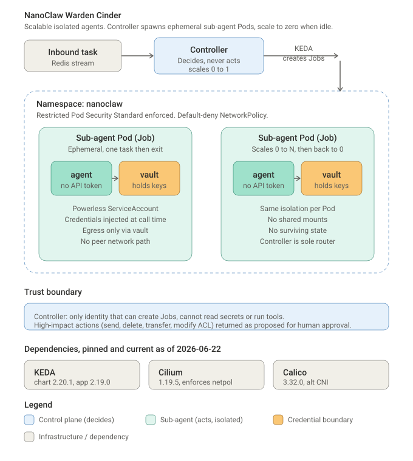

# How NanoClaw Warden Cinder works

This is the full write up. It covers what each piece does, how a task moves through the system, how scaling works from zero to N and back, how every layer of security fits together, and what happens when things break.

Pinned versions as of 2026-11-22: KEDA 2.21.1, Cilium 1.20.5, Calico 3.33.1, Redis 8.10.3, Python 3.13.18, Kubernetes 1.32 or newer. All of them live in `versions.env`.



For a one page view of everything below, see the [mind map](mindmap.svg).

## The short version

You drop a task on a Redis stream. A controller wakes up, splits the task into subtasks, and writes one small message per subtask. KEDA sees the backlog and starts one Kubernetes Job per subtask, up to a cap. Each Job runs one agent that does exactly one subtask, writes its result, and exits. A vault gateway wakes up with the first agent, holds the only copy of the model API key, and is the only pod allowed to leave the cluster. When the work is done, the controller, the vault and the agents all scale back to zero. Redis is the one thing that stays up.

Idle cost is one small Redis pod plus the KEDA operator. Nothing else runs until there is work.

## The pieces

| Piece | Kind | Runs when | Holds | Can reach |
|---|---|---|---|---|
| Redis | Deployment, 1 replica | always | queues, job state, per subtask tokens | nothing outbound |
| Controller | Deployment, 0 to 1 | tasks or results waiting, plus a 3 minute sweep window every 10 minutes | nothing secret | Redis |
| Agent | KEDA ScaledJob, 0 to 20 Jobs | subtasks waiting | one short lived token | Redis, vault |
| Vault | Deployment, 0 to 3 | any agent pod exists or subtasks wait | the model API key | Redis, the upstream API on 443 |
| KEDA | operator in namespace `keda` | always | read only Redis metrics login | Redis (operator pod only) |

Every nanoclaw workload runs from one image (`ghcr.io/djkidnyce/nanoclaw-warden-cinder/runtime:0.2.0`). The container argument picks the role: `controller`, `agent` or `vault`.

### Redis

Redis is the queue and the scale signal. It runs with persistence on (`appendonly yes`) and `noeviction`, so queued work is never silently dropped. It also caps any single value at 1 MB and any client's query buffer at 4 MB. Redis 8.10 defaults to 512 MB and 1 GB, which would let one hijacked agent fill the 400 MB memory cap with a single write and stall every queue. A native sidecar called `bootstrap` creates the three consumer groups every time the pod starts. That matters because KEDA can only read lag from a group that exists.

Redis has seven users and the default user is off. Each user can run only the commands it needs on only the keys it needs:

| User | Allowed |
|---|---|
| `bootstrap` | create consumer groups |
| `controller` | read and ack tasks and results, write subtasks, manage records and tokens, trim streams |
| `agent` | claim and ack subtasks, append to the results stream. Cannot read records, results, tokens, job state or any stream entry it did not claim |
| `vault` | read tokens, count rate and budget. Cannot read task content |
| `keda` | read stream metadata only (`XINFO`, `XLEN`, `XPENDING`). Cannot read entries |
| `client` | append tasks, read job status, completions, approvals and the dead letter queue |

The ACL file holds SHA256 hashes, never plaintext passwords. `scripts/gen-secrets.sh` creates it.

### Controller

The controller has no Kubernetes API access and no model credentials. It does four jobs.

1. Reads `nanoclaw:tasks`, validates each task, and splits it into subtasks.
2. For each subtask it writes a record (`nanoclaw:task:<id>`) that only it can read, mints a random token, stores the token's SHA256 under `nanoclaw:tok:<hash>` for the vault, and appends a message to `nanoclaw:subtasks` carrying the subtask id, the body and the token. Redis delivers a stream message only to the consumer that claims it, and agents have no right to list the stream, so no agent ever sees another subtask's body or token.
3. Reads `nanoclaw:results`, checks each result against the record it issued, stores it, revokes the token, routes any proposed actions to the approval stream, and marks the task finished when the last subtask reports.
4. Sweeps for stranded work, requeues it, dead letters it after three attempts, and trims consumed stream entries.

Validation is strict. A task may only have the fields `id`, `goal` and `subtasks`. Ids must match `^[A-Za-z0-9][A-Za-z0-9_.:-]{0,95}$`. There can be at most 50 subtasks and 32,000 characters per text field. A subtask may only ask for tools listed in `ALLOWED_TOOLS`. Anything else is rejected onto `nanoclaw:completed` with a reason, and no work is created.

### Agent

An agent pod lives for one subtask. It:

1. Resumes its own pending message if it is a retry of the same Job, otherwise claims one new message with `XREADGROUP`.
2. Reads the body and token from that message. It has no access to anything else in Redis except appending a result.
3. Waits for the vault to report ready (the vault may be scaling up from zero at that moment).
4. Builds the prompt. The goal goes in plainly. The input goes inside an `<untrusted_data>` fence, and any text in the input that would close that fence is replaced.
5. Calls the vault with its token. Tools, if any, come from a fixed registry in the image, and only the ones the task was granted.
6. Turns any tool use in the reply into a proposed action. It never performs an action.
7. Appends the result and acks the message in one Redis transaction, then exits 0.

If the vault is unreachable or keeps answering 429 or 5xx, the agent exits 75 and leaves its message pending. Kubernetes retries the Job (up to `backoffLimit: 3`), and because the retry pod keeps the Job name as its consumer name, it picks up the same message. A 401 means the token was revoked because the subtask already finished (a slow original racing a requeued copy), so the agent acks and exits without a second result. Any other 4xx means the request itself is bad, so the agent records an error result instead of retrying forever.

### Vault

The vault is a small HTTP gateway and the only workload that mounts the API key. For every call it:

1. Requires `Authorization: Bearer <token>` and looks up the token's hash. Unknown or expired means 401.
2. Applies a per token rate limit (30 a minute by default) and a lifetime call budget (20 by default). Over either means 429.
3. Refuses bodies over 256 KiB (413), streaming (400), unknown fields (400) and models outside `MODEL_ALLOWLIST` (403).
4. Clamps `max_tokens` to `MAX_TOKENS_CAP`.
5. Refuses tools that are not in the token's grant (403), and screens every tool definition for poisoning: instruction overrides, references to the system prompt, hidden tags, URLs, long base64 blobs and invisible Unicode controls (403).
6. Forwards to `UPSTREAM_URL` with the real key and returns the reply, capped at 2 MiB.

It logs one JSON line per call with the subtask, task, model, status, latency and token counts. It never logs prompt or reply content.

## Life of a task

Here is one task with three subtasks, start to finish.

1. A client runs `nanoclaw cli submit --goal "Review the incident" --subtask "Build a timeline" --subtask "List contributing factors" --subtask "Draft follow ups"`. That appends one entry to `nanoclaw:tasks`.
2. KEDA polls every 5 seconds. Lag on `nanoclaw:tasks` is now 1, so it scales the controller from 0 to 1.
3. The controller validates the task, writes three records and three tokens, and appends three ids to `nanoclaw:subtasks`. Lag there becomes 3.
4. KEDA sees lag 3 and creates three Jobs. At the same moment the vault's trigger fires on that lag and on the new agent pods, so the vault scales from 0 to 1.
5. Each agent claims one id, waits for the vault to be ready, calls it, writes a result to `nanoclaw:results`, acks, and exits.
6. Results lag keeps the controller awake. It stores each result, revokes each token and, after the third, marks the task `completed` and appends to `nanoclaw:completed`.
7. With no lag and no agent pods, the vault scales to zero after 60 seconds and the controller after 120 seconds. Finished Jobs are deleted after 10 minutes.

The client reads the outcome with `nanoclaw cli results <task>` and any proposed actions with `nanoclaw cli approvals`.

## Scaling, in detail

KEDA reads Redis Streams lag with `XINFO GROUPS`. Lag is the count of entries added to a stream that no consumer in the group has claimed yet. KEDA's documentation is explicit that `lagCount` is the only Redis Streams mode that can scale to zero, and that it needs Redis 7 or newer.

| Workload | Triggers | Min | Max | Back to zero after |
|---|---|---|---|---|
| Agents (ScaledJob) | lag on `nanoclaw:subtasks`, 1 Job per unit of lag | 0 | 20 | each Job exits when its subtask is done |
| Vault (ScaledObject) | agent pods exist (1 vault per 8 agents), or lag on `nanoclaw:subtasks` | 0 | 3 | 60 s cooldown |
| Controller (ScaledObject) | lag on `nanoclaw:tasks`, lag on `nanoclaw:results`, cron window minutes 0 to 3 of every 10 | 0 | 1 | 120 s cooldown |

Why the `accurate` job strategy. KEDA's `default` strategy subtracts running Jobs from the queue length. Our lag already excludes claimed work, so `default` would subtract twice and start too few agents. `accurate` caps new Jobs at the max minus running Jobs, and otherwise starts the queue length minus Jobs still pending. That matches a metric that excludes in flight work.

Why the cron window. If an agent dies after claiming a subtask, the message sits in the pending list but adds no lag, so nothing would ever wake the controller to recover it. The sweep window guarantees a controller pass at least every 10 minutes.

Why trimming is careful. The controller only trims entries below both the oldest pending entry and the group's last delivered id. Trimming that way keeps `XINFO GROUPS` lag valid, which the integration tests check on every run.

Timing you can expect on a real cluster: KEDA polls every 5 seconds, then a pod needs scheduling and a container start. With the image already on the node, the first agent is usually running within 10 to 20 seconds of a task landing. Agents wait up to 180 seconds for the vault, which covers a cold vault on a slow node.

In the local scale test, with a 1.5 second simulated cold start and a cap of 5, a burst of 12 subtasks went from idle to 5 running agents in 0.5 seconds, the vault was serving 1.5 seconds later, all 12 subtasks finished at 5.3 seconds, and everything was back at zero at 8 seconds with the cooldowns shortened to 2 seconds. Real numbers will be slower because pods are slower than processes, but the shape is the same.

## Security, layer by layer

The design assumes the model can be talked into anything. OWASP lists prompt injection as the top risk for LLM applications and is clear that no reliable prevention exists, so every control below works even if the model is fully compromised.

### Identity
None of the four nanoclaw service accounts has a Role or RoleBinding, and none mounts a token. No nanoclaw pod can call the Kubernetes API at all. KEDA creates agent Jobs with its own identity.

### Admission
Two ValidatingAdmissionPolicies run inside the API server, with no webhook to operate.

1. Job guard. In the `nanoclaw` namespace only `system:serviceaccount:keda:keda-operator` may create Jobs. Even KEDA's Jobs are refused unless they run as `nanoclaw-agent`, mount no token, and set `activeDeadlineSeconds` of an hour or less. A cluster admin running `kubectl create job` is refused too.
2. Pod guard. Every pod must use an image from the allow list (matched on the full repository, so `runtime-evil` does not pass for `runtime`), must run as a nanoclaw identity, must not mount a token, and must not get ephemeral debug containers. With the `digest-pinning` component, images must also carry a `@sha256:` digest.

Both bindings use `parameterNotFoundAction: Deny`, so deleting the parameter ConfigMap closes the door instead of opening it. Pod Security Admission enforces the `restricted` profile on the namespace as a second, independent check.

3. Pod creator lock (optional component). Only Kubernetes' Job and ReplicaSet controllers may create pods in the namespace. Without it, anyone with pod create rights in `nanoclaw` could start a pod that mounts the agent's Redis password and acts as an agent. It also blocks `kubectl run` and `kubectl debug` for people. The CI kind job runs with it on.

### Network
The namespace starts with deny all in both directions. These are the only flows:

| From | To | Port |
|---|---|---|
| every pod | cluster DNS | 53 |
| controller | Redis | 6379 |
| agent | Redis | 6379 |
| agent | vault | 8200 |
| vault | Redis | 6379 |
| vault | upstream API | 443 |
| KEDA operator pod | Redis | 6379 |

The vault's way out depends on the overlay. With Cilium it is a `CiliumNetworkPolicy` that allows `api.anthropic.com` by name, learned through Cilium's DNS proxy. With Calico or any standard enforcer it is the three address ranges Anthropic publishes for its API: `160.79.104.0/23`, `153.61.224.0/22` and `2607:6bc0::/48`.

Because NetworkPolicy applies to a whole pod, the vault had to be its own Deployment. In the first version it was a sidecar, which meant the agent container shared its internet access. That gap is closed now and a test proves it.

Traffic inside the namespace (Redis passwords, tokens, task text) is plaintext by default. With Cilium, `./scripts/install.sh --encrypt` turns on WireGuard so pod traffic between nodes is encrypted. Cilium's docs note that traffic between pods on the same node is not encrypted, since it never leaves the host. The other route is managed Redis with TLS (`REDIS_TLS=true`).

### Credentials
The API key exists in one Secret, mounted as a file into one Deployment. Redis passwords are mounted as files, never as environment variables, which is also what DISA Kubernetes STIG rule V-242415 requires. Agent tokens are random, delivered only to the agent that claims the subtask, limited in calls and rate, expire after 30 minutes, and are deleted the moment the result arrives. A replayed token gets a 401.

### Workload hardening
Every container runs as a non root UID, drops all capabilities, uses a read only root filesystem and the `RuntimeDefault` seccomp profile, and has CPU and memory requests and limits. Service links are off. A ResourceQuota caps the namespace at 40 pods, 120 Jobs, 12 CPU of requests and 48 GiB of memory limits, whatever KEDA asks for. The optional `gvisor` component runs agents under gVisor so code an agent is tricked into running never touches the host kernel directly.

### What the model is allowed to do
Nothing executes. Tool use becomes a proposal on `nanoclaw:approvals` for a human to review. A malicious input can make an agent produce a bad proposal or bad text, but it cannot send, delete, pay or change anything by itself.

## When things break

| Failure | What happens |
|---|---|
| Agent crashes before claiming | KEDA sees the lag still there and starts another Job |
| Agent crashes after claiming | The retry pod (same Job name) resumes the same message. If the Job gives up, the controller's sweep requeues the message after the 20 minute visibility timeout, so the lag returns and a new Job starts |
| Subtask keeps failing | After 3 attempts it goes to `nanoclaw:dlq` and the task is marked `partial` or `failed` |
| Vault is still starting | Agents wait up to 180 seconds for `/readyz` |
| Upstream returns 429 or 5xx | The agent backs off and retries up to 5 times, then exits 75 so the Job retries |
| Controller dies mid batch | Its unacked messages are reclaimed by the next controller after 2 minutes idle |
| Redis container restarts | The data volume survives, so AOF replays streams and groups |
| Redis pod is rescheduled | The default volume is an emptyDir, so Redis comes back empty. The bootstrap sidecar recreates the groups, and the controller does too if it notices first. In flight tasks are lost; resubmit them, or give Redis a PersistentVolume (see CONFIGURATION.md) |
| Same task submitted twice | The second copy is ignored, keyed on the task id |
| Forged result on the results stream | Dropped unless it matches a subtask record the controller issued |

## Observability

Every component logs one JSON object per line with `ts`, `level`, `component` and `msg`, plus fields such as `task`, `subtask`, `status`, `model`, `ms`, `input_tokens` and `output_tokens`. Content never reaches the logs. Useful views:

```bash
kubectl -n nanoclaw get scaledjob,scaledobject,deploy,jobs
kubectl -n nanoclaw logs deploy/vault | grep '"denied"'
kubectl -n nanoclaw get events --field-selector reason=SuccessfulCreate
```

KEDA exposes Prometheus metrics for each scaler. Cilium's Hubble shows every allowed and dropped flow, which is the quickest way to confirm the network table above on a live cluster.

## Known limits

Redis is a single replica. For production, move it to a managed Redis with TLS or a replicated StatefulSet, and set `REDIS_TLS=true`. The vault's tool screening is pattern based and will not catch every poisoning attempt, which is why tools never execute. A jailbroken agent can still write misleading text into its result, so treat results as untrusted when you act on them. During its 15 minute life a hijacked agent can also claim extra subtasks and sit on them, or append junk results; the first delays work until the sweep requeues it, the second is dropped by the controller and bounded by the Redis size caps. Image signatures are produced on release but not verified at admission; add Sigstore policy controller or Kyverno if you need that.
